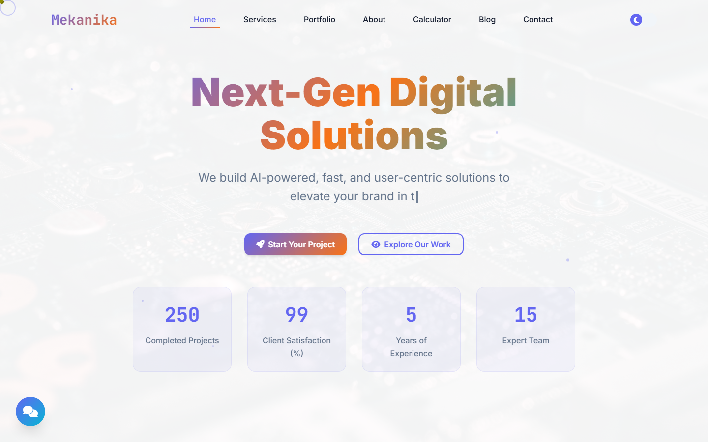

# Mekanika - Digital Agency Website

A modern, single-page website for a fictional digital agency. It features an animated hero with typewriter text, counters, a services and portfolio showcase, a blog section, an interactive pricing calculator and a light/dark theme.



**[Live demo](https://arifaydin12.github.io/mekanika-agency-website/)**

## Highlights

- **Design system with CSS custom properties**: a full light and dark palette, switched with one toggle
- **Animated hero**: gradient headline, typewriter subtitle and animated statistic counters
- **Sections**: Home, Services, Portfolio, About, Calculator, Blog, Careers, FAQ and Contact
- **Pricing calculator** that estimates a project cost from the options you pick
- **Floating chat button** and a custom animated cursor
- **Responsive** layout with smooth scrolling and scroll-triggered animations
- Everything lives in one self-contained HTML file: no build step, no framework

## Tech stack

HTML5, CSS3 (variables, Grid, Flexbox, animations), vanilla JavaScript, Font Awesome, Google Fonts (Inter and JetBrains Mono).

## Run locally

Open `index.html` in a browser, or serve the folder:

```bash
npx serve .
```

## License

[MIT](LICENSE) © Arif Enes Aydin
